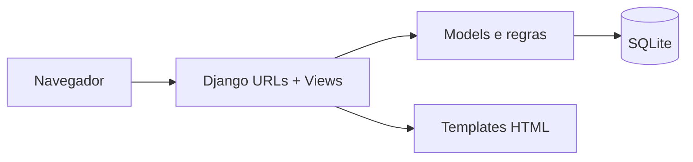

<div align="center">

# 🚕 Taxi Service — Home Page
### Dashboard inicial com Django


</div>

## 🎯 Sobre o projeto

Etapa educacional de um sistema Django para serviços de táxi. A branch de funcionalidade implementa o fluxo da página inicial, conectando rotas, view e templates.

**Código relevante:** branch [`feature/taxi-home-page`](https://github.com/WalterMatheusgg/py-taxi-service-home-page/tree/feature/taxi-home-page). Desenvolvido como parte de exercícios práticos com Django; não representa um sistema comercial de transporte.

## ✨ Funcionalidades e estrutura

| Área | Recurso presente na implementação |
|:--|:--|
| **Home** | View para apresentar dados resumidos do projeto. |
| **Rotas** | Ligação das URLs do projeto às URLs da aplicação `taxi`. |
| **Modelos** | Uso de entidades de carros, motoristas e fabricantes. |
| **Templates** | Interface renderizada pelo Django. |

## 🏗️ Arquitetura



Organização principal da aplicação:

```text
taxi/             # Models, views, admin e rotas
taxi_service/     # Configuração Django
templates/        # Páginas HTML (quando aplicável)
manage.py         # Comandos do Django
```

## 🚀 Executar localmente

Use um ambiente Python isolado, com versão compatível com as dependências do projeto.

```bash
git clone -b feature/taxi-home-page https://github.com/WalterMatheusgg/py-taxi-service-home-page.git
cd py-taxi-service-home-page
python3 -m venv .venv
source .venv/bin/activate
python -m pip install -r requirements.txt
python manage.py migrate
python manage.py check
python manage.py runserver
```

Acesse **http://127.0.0.1:8000/**.

Para testar funcionalidades existentes:

```bash
python manage.py test
```

**Observação:** não executei o projeto ou a suíte nesta revisão. Em algumas etapas, os testes são fornecidos como parte do enunciado do curso e podem exigir configuração adicional.

## 🔒 Limites e cuidados

Esta etapa integra uma trilha de exercícios Django; não é um produto de gestão de frota pronto para produção.

Use somente dados de teste. Não reutilize senhas presentes em fixtures, mantenha `DEBUG` desabilitado em servidores públicos e revise dependências antes de qualquer implantação externa.

## 👨‍💻 Repositório

**Walter Matheus Soares da Silva** · [GitHub](https://github.com/WalterMatheusgg)

Outros projetos do portfólio: [NEXUS CRM](https://github.com/WalterMatheusgg/NEXUS) · [Biblioteca Digital](https://github.com/WalterMatheusgg/library-service/tree/develop)
